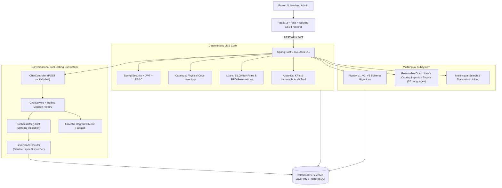

# LibraAI — AI-Augmented Multilingual Library Management System 📚🤖🌍

**LibraAI** is an industrial-grade Library Management System (LMS) built with a **deterministic core system of record** in Java 21 / Spring Boot 3, and a modern, high-performance **React 18 + TypeScript + Vite + Tailwind CSS** frontend.

It features **multilingual catalog support across 20+ languages**, a **resumable real-world Open Library catalog ingestion engine**, and an advanced **conversational tool-calling AI assistant** that executes validated service calls against the catalog without ever touching the database directly.

---

## 🏛️ System Architecture



---

## 🌟 Key Features & Subsystems

### 1. 🌍 Multilingual Catalog & Translation Linking (`/api/v1/books`)
- **Flyway Database Migrations**:
  - `V1__initial_schema.sql`: Initial core LMS tables.
  - `V2__add_multilingual_support_to_books.sql`: Added `language` (ISO 639-1, indexed, default `'en'`), `original_language`, and `translated_from_id` foreign key.
  - `V3__add_import_progress_table.sql`: Checkpointing table for resumable imports.
- **Language Filtering**: Filter catalog holdings by dropdown or interactive language chips (**English, தமிழ், हिन्दी, বাংলা, తెలుగు, संस्कृतम्, 日本語, 中文, العربية, Русский, Español, Français, Deutsch, Korean, Greek, Latin**, and more).
- **Translation Linking**: Books link back to their original work (`translatedFrom`) and dynamically discover other translations ("*Also available in: Tamil, Hindi*").

### 2. 📥 Resumable Multilingual Catalog Ingestion Engine (`/api/v1/admin/import-books`)
- **Real-World Public Data**: Ingests real books from Open Library's Search API across **20 languages** and **6 subjects** (*Fiction, Science, History, Poetry, Biography, Philosophy*).
- **Deduplication & Validation**: Deduplicates records on ISBN, discards malformed records missing authors/titles, maps language and categories, and seeds physical copies (`AVAILABLE`).
- **Resumability & Rate Limiting**: Persists progress in `import_progress` so restarts pick up from the last checkpoint without duplicate network calls.
- **How to Re-run / Trigger**:
  ```http
  POST /api/v1/admin/import-books?targetPerQuery=50&resume=true
  Authorization: Bearer <ADMIN_JWT_TOKEN>
  ```
  Check status anytime:
  ```http
  GET /api/v1/admin/import-status
  ```

### 3. 🤖 Conversational Tool-Calling AI Assistant (`/api/v1/chat`)
Replaced single-shot NLU with a **multi-turn tool-calling architecture**:
- **Strict Database Separation**: The LLM **never touches the database directly**. All tool requests route through strictly validated Java service methods.
- **Fixed 5-Tool Surface**:
  1. `searchBooks(query, language?, category?, availableOnly?)`: Multi-criteria catalog search.
  2. `getBookDetails(bookId)`: Fetches metadata, stock copies, original work, and translation links.
  3. `getAuthorWorks(authorId?, authorName?)`: Retrieves books by a specific writer.
  4. `getSimilarBooks(bookId)`: Finds similar books based on category and authors.
  5. `getRecommendationsForMember(memberId?, username?)`: Personalized patron recommendations.
- **Tool Validation Engine ([`ToolValidator.java`](file:///c:/Users/gokul/OneDrive/Desktop/library/backend/src/main/java/com/libraai/chat/tool/ToolValidator.java))**: Validates parameter types, required fields, and bounds (e.g. `bookId > 0`). Out-of-schema calls are rejected and logged as `REJECTED` before reaching the repository layer.
- **Rolling Server-Side Session History**: `ChatSessionManager` maintains a 15-turn rolling context per session ID with 24-hour TTL eviction.
- **Catalog Grounding Flags**:
  - `groundedInCatalog = true` & badge `From our catalog` (emerald) when tool-backed.
  - `groundedInCatalog = false` & badge `General knowledge` (indigo) for general literary analysis.
  - `isDegraded = true` & badge `Degraded / Fallback Mode` (amber) with direct keyword search fallback if provider times out or fails.
- **Interactive UI ([`ChatPanel.tsx`](file:///c:/Users/gokul/OneDrive/Desktop/library/frontend/src/components/ChatPanel.tsx))**: Integrated directly above the catalog with starter prompts, typing indicator, and direct book modal navigation.

### 4. 🔄 Circulation & Operations (`/api/v1/loans`, `/api/v1/fines`, `/api/v1/reservations`)
- **Deterministic Loan Rules**: 14-day checkout duration, max 5 active loans per member.
- **Renewals**: Up to 2 renewals (+14 days), blocked if overdue or reserved.
- **Overdue Engine**: Deterministic \$1.00/day fine calculation on late return with live payment tracking.
- **FIFO Reservations**: Automated reservation queue fulfillment upon return.

### 5. 📊 Analytics & Immutable Audit Trail (`/api/v1/analytics`)
- Real-time KPIs: Catalog titles, total copies, active loans, overdue rate, fine revenues.
- Immutable system audit trail capturing all checkouts, returns, payments, and catalog modifications.

---

## 🚀 Quick Start Guide

### Prerequisites
- **Java JDK 21+** (e.g. `C:\Program Files\Java\jdk-26.0.1`)
- **Maven 3.8+**
- **Node.js 18+** & **npm**

---

### Step 1: Start the Spring Boot Backend

```powershell
cd backend
$env:JAVA_HOME = "C:\Program Files\Java\jdk-26.0.1"
mvn spring-boot:run
```

- **Backend REST API**: `http://localhost:8080`
- **Swagger OpenAPI Documentation**: `http://localhost:8080/swagger-ui.html`
- **System Health Diagnostics**: `http://localhost:8080/api/v1/health`
- **H2 Database Console**: `http://localhost:8080/h2-console` (JDBC URL: `jdbc:h2:mem:libraaidb`, User: `sa`, Password: *blank*)

---

### Step 2: Start the React Frontend

```powershell
cd frontend
npm install
npm run dev
```

- **Frontend Application**: `http://localhost:5173`

---

## 🔑 Pre-Seeded Test Accounts

All pre-seeded test accounts use the password: `password123`

| Username | Role | Email | Description |
| :--- | :--- | :--- | :--- |
| `admin` | `ROLE_ADMIN` | `admin@libraai.local` | Full administrative privileges, user management, and ingestion triggering |
| `librarian` | `ROLE_LIBRARIAN` | `librarian@libraai.local` | Catalog additions, circulation desk barcode management, and analytics |
| `member` | `ROLE_MEMBER` | `member@libraai.local` | Patron dashboard, active loans, 1-click renewal, reservations, and AI Assistant |

---

## 🧪 Automated Testing

Run the full automated test suite (**43 unit and integration tests** passing across all subsystems):

```powershell
cd backend
mvn test
```

```text
[INFO] Results:
[INFO] 
[INFO] Tests run: 43, Failures: 0, Errors: 0, Skipped: 0
[INFO] 
[INFO] ------------------------------------------------------------------------
[INFO] BUILD SUCCESS
[INFO] ------------------------------------------------------------------------
```
